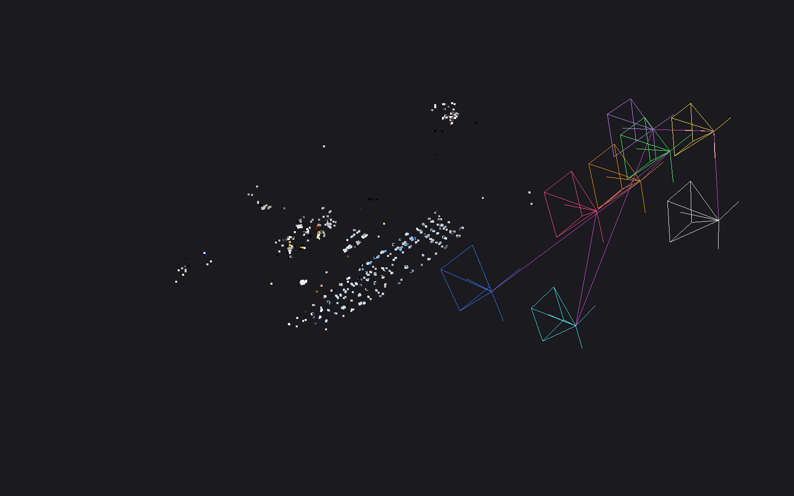
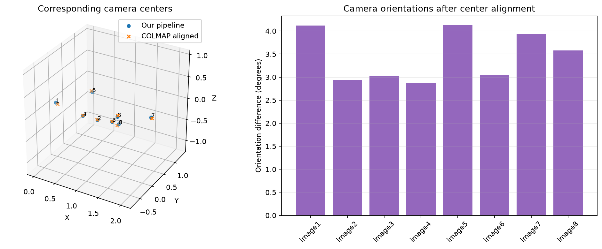
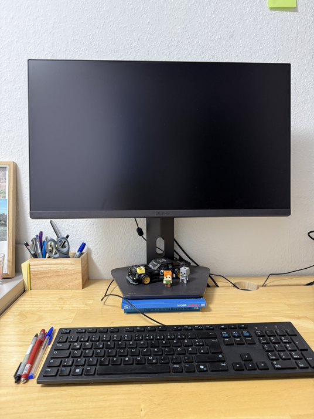
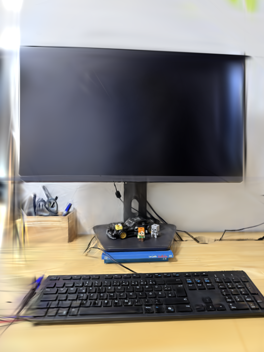
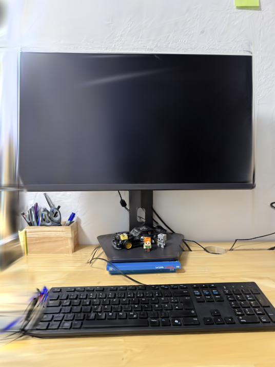

# Reconstruction Results

## Dataset

Eight overlapping photographs of a static desk scene were captured using
the same iPhone 16 Pro main lens at 1× zoom.

- Oriented image dimensions: 4284 × 5712 pixels.
- Approximate focal length: fx = fy = 3960.6 pixels.
- Approximate principal point: (2142, 2856).
- Shared, fixed pinhole intrinsics.
- Lens distortion is not explicitly modeled.
- Reconstruction scale is arbitrary; coordinates are not measured in meters.

The intrinsics were estimated from image dimensions and EXIF information,
rather than obtained through camera calibration.

## Implementation

The project implements:

- Pinhole projection and camera-pose transformations.
- Descriptor matching with NumPy and Lowe's ratio test.
- Point normalization and the normalized eight-point algorithm.
- Fundamental-matrix RANSAC with Sampson-error scoring.
- Fundamental-to-essential matrix conversion.
- Essential-matrix decomposition and cheirality-based pose selection.
- Linear triangulation using SVD.
- Reprojection-error and triangulation-angle filtering.
- Feature-track ownership and incremental map expansion.
- Sparse bundle-adjustment residuals, parameterization, and Jacobian sparsity.
- Similarity alignment for comparison with COLMAP.
- Export of the custom reconstruction to a COLMAP-compatible dataset format.
- Camera-path interpolation and video-rendering integration.

External components include:

- OpenCV SIFT feature extraction.
- OpenCV direct essential-matrix estimation for the final reconstruction.
- OpenCV PnP-RANSAC and pose refinement.
- SciPy nonlinear least-squares optimization and rotation interpolation.
- Open3D visualization and point-cloud export.
- COLMAP for an independent reconstruction baseline.
- The Graphdeco Gaussian Splatting implementation for Gaussian optimization
  and CUDA rendering.

The final reconstruction uses directly estimated essential geometry.
The custom fundamental-matrix pipeline remains an experimental baseline.

## Eight-View Reconstruction

Before global bundle adjustment:

| Metric | Value |
|---|---:|
| Registered images | 8 |
| 3D points | 1,419 |
| Feature observations | 4,027 |
| RMS reprojection error | 1.004 px |

Global bundle adjustment:

- Optimized camera poses and 3D point positions.
- Kept camera 1 fixed to define the world coordinate system.
- Fixed one translation component of camera 2 to anchor scale.
- Kept intrinsics fixed.
- Used a robust soft-L1 objective and sparse numerical derivatives.
- Satisfied the solver's relative-cost termination criterion after
  25 function evaluations.

| Metric | Before BA | After BA |
|---|---:|---:|
| RMS reprojection error | 1.004 px | 0.775 px |
| Robust objective | 1469.224 | 939.042 |

These errors use identical observations before final filtering.
The RMS reprojection error decreased by approximately 23%.

After filtering invalid or high-error observations and weak tracks:

| Metric | Value |
|---|---:|
| Registered images | 8 |
| Retained 3D points | 1,413 |
| Retained feature observations | 4,013 |
| Mean track length | 2.84 |

The 0.775 px RMS value describes the pre-filtering comparison.
It should not be presented as a separately measured post-filtering RMS.

Eight-view sparse reconstruction after global bundle adjustment.
Camera wireframes show estimated poses. For presentation only,
1,384 of 1,413 points are displayed; 29 distant points are hidden.
This display crop does not remove points from the saved reconstruction.

## COLMAP Comparison

COLMAP reconstructed the same eight images using shared, fixed PINHOLE
intrinsics.

For memory control, COLMAP feature extraction used a maximum image
dimension of 3200 pixels, first octave 0, and a feature budget of 2000.
The custom pipeline used full-resolution images for OpenCV SIFT extraction.
Feature sets, matching behavior, and observation sets therefore differ.

| Metric | Custom pipeline | COLMAP |
|---|---:|---:|
| Registered images | 8 | 8 |
| 3D points | 1,413 | 2,813 |
| Feature observations | 4,013 | 10,060 |
| Mean track length | 2.84 | 3.58 |

COLMAP produced approximately twice as many sparse points and more
observations per point.

COLMAP's reported mean reprojection error was 1.206 px. This is not
directly comparable to the custom pipeline's 0.775 px pre-filtering RMS:
the aggregation and underlying observations differ.

## Camera-Pose Agreement

Camera centers were matched by image filename. A seven-parameter
similarity transform aligned COLMAP's centers to the custom
reconstruction's coordinate system.

| Metric | Result |
|---|---:|
| Shared cameras | 8 |
| Aligned center RMS difference / initial baseline | 3.25% |
| Leave-one-camera-out center RMS / initial baseline | 5.54% |
| Median orientation difference | 3.32° |
| Maximum orientation difference | 4.12° |

The initial baseline is the distance between cameras 1 and 2 in the
custom reconstruction.

The aligned center RMS is evaluated on the same cameras used to fit the
similarity transformation. It therefore measures in-sample agreement.

The leave-one-camera-out evaluation fits an alignment using seven cameras
and evaluates the excluded camera, repeating this for all eight cameras.

The orientation comparison uses the alignment fitted from camera centers.
Orientations were not independently aligned.

These values measure agreement between two reconstructions.
COLMAP is a reference system, not ground truth.

## Gaussian Splatting Integration

The custom reconstruction's refined camera poses and 1,413 colored sparse
points were exported to a COLMAP-compatible dataset format. COLMAP was
not used to estimate the geometry for this initialization.

Gaussian optimization and rendering used the external
[Graphdeco Gaussian Splatting implementation](https://github.com/graphdeco-inria/gaussian-splatting).

The renderer's initialization message confirmed that it loaded
1,413 points from the custom reconstruction.

### Experimental setup

Both initialization experiments used:

- Eight registered cameras.
- Seven appearance-training images and one held-out image.
- 3,000 optimization iterations.
- Resolution factor 8.
- Spherical-harmonic degree 1.
- Densification starting at iteration 500 and ending at iteration 2500.
- Densification interval of 200 iterations.
- Densification gradient threshold of 0.0005.

The experiments used an NVIDIA GeForce RTX 3060 Laptop GPU with 6 GB VRAM.
The tested environment used Python 3.12, PyTorch 2.9.0+cu130, and
CUDA Toolkit 13.0.

The run initialized from the custom SfM map completed training in
approximately 91 seconds. This is an observed run time, not a controlled
benchmark.

### Held-out appearance evaluation

Saved test renders were compared against an identical reference image
at 536 × 714 pixels.

| Initialization | Initial points | Test PSNR ↑ | Test L1 ↓ |
|---|---:|---:|---:|
| COLMAP | 2,813 | 21.632 dB | 0.038443 |
| Custom SfM | 1,413 | 19.788 dB | 0.052646 |

Higher PSNR and lower L1 indicate closer pixel agreement with the
reference image.

COLMAP initialization achieved 1.844 dB higher test PSNR in this
experiment. Camera poses, initial point locations, colors, and coverage
differ between the initializations, so the difference cannot be
attributed to point count alone.

The training log for custom SfM initialization reported:

| Evaluation | PSNR |
|---|---:|
| Training-view evaluation | 28.338 dB |
| Held-out image | 19.795 dB |

The small difference between the logged test PSNR and the saved-PNG
measurement results from evaluating floating-point renders versus
quantized image files.

The training-view and held-out results show substantially better
appearance agreement on views used for Gaussian optimization.

| Reference | Custom SfM initialization | COLMAP initialization |
|---|---|---|
|  |  |  |

### Evaluation scope

The held-out image was excluded from Gaussian appearance optimization.
Both SfM reconstructions used all eight photographs.

This evaluates appearance prediction with estimated cameras, rather than
a fully held-out end-to-end reconstruction.

The results cover one held-out view of one scene and do not establish
general performance across datasets. The experiment was not repeated
across multiple random seeds.

### Camera-path demonstration

An eight-second video was rendered by interpolating camera centers
and rotations through cameras 1, 2, and 3 and returning along the path.

Camera centers were interpolated linearly between adjacent poses,
and orientations were interpolated using spherical linear interpolation.
An eased playback schedule was used for the forward-and-back motion.

[Watch the camera-path video](assets/camera_path.mp4)

Intermediate viewpoints have no reference photographs. The video
demonstrates rendering behavior and visible artifacts, not geometric
accuracy.

Remaining artifacts include blur, streaks, and doubled edges,
particularly around the keyboard, image boundaries, and weakly
constrained regions.

## Validation and Limitations

### Synthetic geometry

The noiseless tests recovered known camera poses and 3D points to
numerical precision.

A noisy synthetic bundle-adjustment experiment exposed a limitation:
reprojection error decreased while error against the known 3D geometry
increased. Dense and accurately solved sparse optimization reached
essentially the same solution.

Consequently, low reprojection error alone is not treated as evidence of
accurate 3D geometry. Noise sensitivity and geometric conditioning remain
open evaluation topics.

### Custom fundamental-matrix baseline

The custom eight-point and RANSAC implementation passed its noiseless
synthetic checks. On the real dataset, converting its estimated F to a
constrained E produced substantially worse pose reprojection errors than
direct essential-matrix estimation.

The cause has not been conclusively isolated.

### Camera calibration and scale

The reconstruction uses approximate intrinsics and does not explicitly
model residual lens distortion.

All reconstructed positions are expressed in arbitrary map units.
No physical reference distance was used to establish metric scale.

The real scene was not evaluated against ground-truth camera poses
or measured 3D geometry.

### Reconstruction coverage

The SfM output is a sparse feature-based reconstruction, not a dense
surface or mesh. Smooth, reflective, and weakly textured regions have
limited coverage. Repeated patterns can produce ambiguous matches.

Track ownership prevents reuse of the same feature in multiple tracks,
but uncertain track merges and multiple descriptors per landmark are
not yet implemented.

Gaussian Splatting provides an appearance representation for rendering;
it does not turn the sparse reconstruction into a validated surface mesh.

### Optimization

Solver convergence refers to numerical termination of a local objective.
It does not establish a global optimum or metric scene accuracy.

### Resource use

An isolated full-resolution OpenCV SIFT extraction reached approximately
5.42 GiB peak resident memory. Repeated WSL service failures occurred
during the initial incremental run.

Feature extraction was subsequently isolated in subprocesses and cached
on disk. The remaining images registered successfully after this change.
Memory pressure is a suspected contributor, not a confirmed crash cause.

### Reproducibility

The reported results describe the tested scene, environment, and settings.
A clean-environment reproduction has not yet been independently verified.

Gaussian Splatting uses a separate environment and compiled CUDA
extensions. A local C++ header compatibility fix was required when
building the rasterizer with CUDA Toolkit 13.0.
